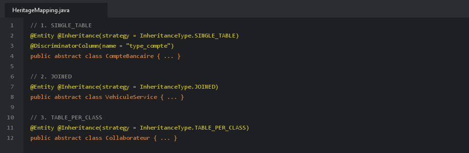
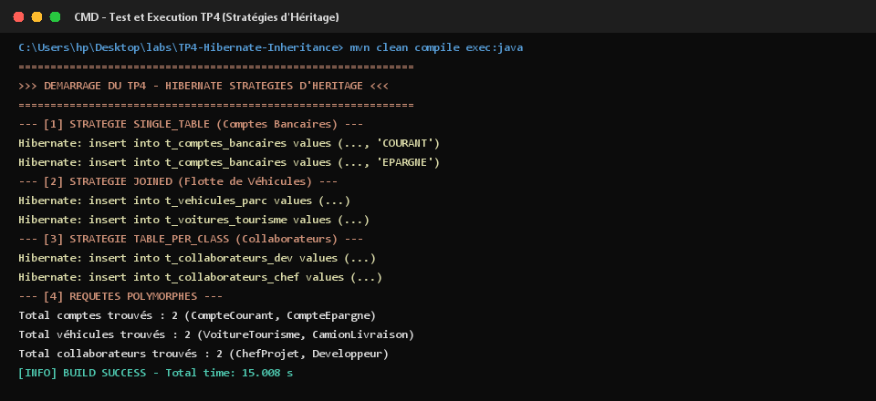

# TP 4 : Héritage avec Hibernate - Stratégies de Mapping

Ce projet implémente et compare les trois stratégies de mapping d'héritage objet-relationnel fournies par **JPA** et **Hibernate ORM** avec une base de données **H2**.

---

## 1. Classes et Stratégies d'Héritage Implémentées

Voici la mise en œuvre des 3 stratégies (`SINGLE_TABLE`, `JOINED`, et `TABLE_PER_CLASS`) :



1. **`SINGLE_TABLE`** : Hiérarchie `CompteBancaire` (`CompteCourant` et `CompteEpargne`) avec colonne discriminante.
2. **`JOINED`** : Hiérarchie `VehiculeService` (`VoitureTourisme` et `CamionLivraison`) avec tables jointes par clés primaires.
3. **`TABLE_PER_CLASS`** : Hiérarchie `Collaborateur` (`Developpeur` et `ChefProjet`) avec tables distinctes autonomes.

---

## 2. Traces et Résultats de Tests dans le Terminal (CMD)

Exécution du test polymorphique démontrant les insertions et les requêtes SQL appropriées pour chaque stratégie :



---

## 3. Démarrage et Exécution

```bash
# Compilation et test
mvn clean compile exec:java "-Dexec.mainClass=ma.enset.tp4.App"
```
